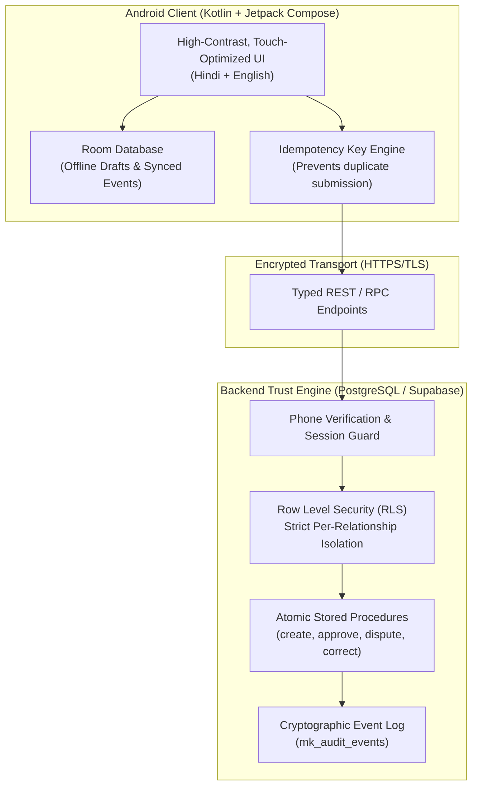

# 🤝 Mutual Khata
<p align="center">
  <strong>दोनो का हिसाब • दोनो की तस्दीक</strong><br>
  <em>(Dono Ka Hisaab. Dono Ki Tasdeeq.)</em><br>
  <strong>A tamper-proof, bilateral shared credit ledger engineered for India's micro-retailers and distributors.</strong>
</p>

<p align="center">
  
  
  
  
  
  
</p>

---

## 📖 Executive Summary

In India's informal retail trade ecosystem, credit (*udhaar*) is the lifeblood of daily commerce. A local grocery store (*kirana*) buys FMCG goods on rolling credit from multiple distributors, paying in installments as stock sells.

Today, this multi-billion dollar credit ecosystem relies on **unilateral record-keeping**: separate physical paper notebooks (*bahi-khatas*) or one-sided mobile apps. When amounts differ at week-end reconciliation, mistrust surfaces:
- *Was that ₹5,000 cash collection entered into the distributor's books?*
- *Did the shopkeeper acknowledge the damaged biscuit cartons?*
- *Who changed that ₹12,000 invoice to ₹14,000 three weeks later?*

**Mutual Khata** solves this by establishing a **bilateral, server-authoritative pair ledger** where:
1. **No transaction is confirmed unilaterally.**
2. **No confirmed entry can ever be silently edited or deleted in-place.**
3. **Every correction is an append-only revision requiring counterparty consent.**

> **Product Thesis:**  
> *Small retailers and distributors should be able to maintain one shared, unambiguous account of goods supplied, payments acknowledged, and adjustments approved—without either side possessing the power to silently rewrite history.*

---

## ⚡ The Fundamental Shift: Unilateral vs. Mutual

| Dimension | Typical Khata Apps (Status Quo) | Mutual Khata |
| :--- | :--- | :--- |
| **Trust Model** | **Unilateral.** One user types; the other is passively sent a reminder. | **Bilateral Consensus.** Requires explicit counterparty approval. |
| **Mutation Integrity** | Confirmed rows can be edited, overwritten, or deleted by whoever typed them. | **Immutable Event Log.** Confirmed entries are write-once, append-only. |
| **Corrections** | In-place overwriting hides previous agreements. | **Linked Reversals.** Side-by-side diff with audit reason and author. |
| **Dispute Handling** | No native dispute state; either deleted or left as an argument on WhatsApp. | **First-Class Dispute State.** Disputed items stay visible but isolated. |
| **Balance Integrity** | Unverified or contested claims immediately alter the total balance. | **Strict Balance Isolation.** Unconfirmed & disputed items never pollute balance. |
| **Field Delegation** | Delivery boys share owner logins or text receipts informally. | **Scoped Field-Agent Roles.** Owner delegates shop visits with full actor audit. |
| **Offline Semantics** | "Last write wins" or unverified optimistic balances. | **Honest Offline Caching.** Unsynced drafts clearly labeled; no offline self-confirm. |

---

## 🏛️ Core Architectural Pillars



### 1. The Append-Only Ledger (`No In-Place Edits`)
In financial systems, mutability is the root cause of fraud and disputes. In Mutual Khata, `UPDATE` and `DELETE` privileges are revoked on active ledger rows. If an invoice of ₹4,850 was entered as ₹4,800 and confirmed:
- The original ₹4,800 event remains permanent in the history.
- The proposer initiates a `Correction Request` linked to the original ID.
- The reviewer inspects the delta (`+₹50`) and reason.
- Upon approval, an `adjustment` event is appended to the ledger.

### 2. Strict State Isolation (`Pending ≠ Confirmed`)
A ledger must never take future or contested credit as cash in hand. The system maintains strict state boundaries:

```mermaid
stateDiagram-v2
    [*] --> LocalDraft: Created offline
    LocalDraft --> AwaitingResponse: Synced to Server with Idempotency Key
    
    state "Awaiting Counterparty Response" as AwaitingResponse {
        [*] --> InReview
    }
    
    AwaitingResponse --> Confirmed: Counterparty Approves
    AwaitingResponse --> Disputed: Counterparty Contests
    AwaitingResponse --> Rejected: Counterparty Declines
    
    state Confirmed {
        direction TB
        PermanentRecord: Active in Canonical Balance
        PermanentRecord --> CorrectionPending: Request Correction
        CorrectionPending --> Corrected: Counterparty Approves Adjustment
        CorrectionPending --> PermanentRecord: Counterparty Declines Adjustment
    }
    
    Disputed --> [*]: Stays visible; 0 balance effect
    Rejected --> [*]: Terminal state; 0 balance effect
    Corrected --> [*]: Balance adjusted via delta event
```



| Transaction State | Meaning | Included in Confirmed Balance? |
| :--- | :--- | :---: |
| **Local Draft** | Stored on the phone; not yet transmitted to the backend. | ❌ **No** |
| **Awaiting Response** | Received by server; awaiting counterparty review. | ❌ **No** |
| **Confirmed** | Acknowledged by the authorized counterparty. | ✅ **Yes** |
| **Disputed** | Explicitly contested with a recorded reason. | ❌ **No** *(zero effect)* |
| **Rejected** | Turned down by counterparty. | ❌ **No** |
| **Correction Pending** | Linked adjustment awaiting counterparty review. | ❌ **No** *(Original remains effective)* |
| **Corrected** | Linked adjustment accepted and appended. | ✅ **Yes** *(Effective delta updated)* |

### 3. Dedicated Field-Agent Workflows
Distributor owners cannot physically visit 80 shops daily. Mutual Khata provides a **Field / Collection Agent** role:
- **Scoped Permissions:** Agents only see retailer accounts assigned to their delivery route.
- **Explicit Attribution:** When an agent collects cash, the receipt states: `Collected by Ramesh (Agent) on behalf of Sharma Distributors`.
- **Zero Self-Approval:** Agents cannot approve their own proposed invoices or alter confirmed figures.

### 4. Honest Offline-First Architecture
Connectivity in wholesale markets (*mandis*) and basement shops is unpredictable:
- **Local Persistence:** Room stores read-only cached transactions and local unsynced drafts.
- **Clear Visual Badging:** Unsynced items are explicitly badged: `Abhi sirf is phone par saved hai` (*Saved only on this phone*).
- **No Optimistic Self-Approval:** An offline action is never displayed as confirmed until server validation and counterparty acknowledgement are complete.
- **Idempotency Safeguard:** Every write incorporates a UUIDv4 idempotency key to prevent double entries on connection reconnects.

---

## 🗄️ Database Schema & Security Spec

The backend is built around strict PostgreSQL relations protected by Row-Level Security (RLS) and atomic Remote Procedure Calls (RPCs).

```
┌─────────────────────────┐         ┌─────────────────────────┐
│       mk_profiles       │         │    mk_relationships     │
├─────────────────────────┤         ├─────────────────────────┤
│ user_id (UUID PK)       │◄───┐    │ id (UUID PK)            │
│ display_name            │    ├───┼┤ retailer_id (UUID FK)   │
│ business_name           │    └───┼┤ distributor_id (UUID FK)│
│ preferred_language      │         │ status (enum)           │
└─────────────────────────┘         └────────────┬────────────┘
                                                 │ 1
                                                 │
                                                 │ *
                                    ┌────────────┴────────────┐
                                    │    mk_ledger_entries    │
                                    ├─────────────────────────┤
                                    │ id (UUID PK)            │
                                    │ relationship_id (FK)    │
                                    │ created_by (FK)         │
                                    │ entry_type (enum)       │
                                    │ amount (Numeric 12,2)   │
                                    │ balance_delta (Numeric) │
                                    │ status (enum)           │
                                    │ confirmed_by (FK)       │
                                    │ confirmed_at (Timestamp)│
                                    │ corrects_entry_id (FK)  │
                                    └────────────┬────────────┘
                                                 │ 1
                                                 │
                                                 │ *
┌─────────────────────────┐         ┌────────────┴────────────┐
│     mk_audit_events     │         │ mk_correction_requests  │
├─────────────────────────┤         ├─────────────────────────┤
│ id (UUID PK)            │         │ id (UUID PK)            │
│ relationship_id (FK)    │         │ entry_id (UUID FK)      │
│ entry_id (UUID FK)      │         │ requested_by (UUID FK)  │
│ actor_id (UUID FK)      │         │ proposed_amount         │
│ event_type (Text)       │         │ reason (Text)           │
│ details (JSONB)         │         │ status (enum)           │
└─────────────────────────┘         └─────────────────────────┘
```

### Key Security Controls:
1. **Integer / Exact Decimal Precision:** Amounts are stored as exact decimals (`numeric(12,2)`) to eliminate floating-point rounding errors.
2. **Actor Enforcements:** Server-side functions guarantee `created_by != confirmed_by`. Self-approval is rejected at the database level.
3. **No Direct Row Mutation:** Client clients lack `UPDATE` grants on `mk_ledger_entries`. All status transitions must pass through stored procedures (`mk_approve_entry`, `mk_dispute_entry`, etc.).

---

## 📱 Mobile Architecture & UX

Designed specifically for fast interactions on budget Android hardware:

- **Minimal Cognitive Overhead:** Large, unambiguous 48dp+ touch targets designed for busy shop counters.
- **Contextual Microcopy (Hinglish / Hindi / English):**
  - `Maal Diya / Udhaar` (Goods supplied)
  - `Payment Darj Karein` (Record payment)
  - `Dono Taraf Se Confirm` (Mutually confirmed)
  - `Galat Hai / Dispute` (Contest transaction)
- **TalkBack & Dynamic Font Support:** High-contrast color palette, color-blind friendly cues (pairing icons with text badges).

### Color Palette Tokens
| Token | Hex Code | Purpose |
| :--- | :--- | :--- |
| **Ink** | `#1C2824` | Primary high-contrast text |
| **Forest Green** | `#176B54` | Confirmed balances & positive credit actions |
| **Soft Sage** | `#E8F3ED` | Background badges for confirmed entries |
| **Amber** | `#9A640D` | Pending actions awaiting review |
| **Carmine Red** | `#B42318` | Disputed records & rejections |
| **Paper Canvas**| `#F7F8F6` | Eye-friendly matte page background |

---

## 📂 Project Structure

```bash
Mutual-Khata/
├── README.md                     # You are here! Master project blueprint & architecture
├── Mutual_Khata_PRD_v0.1.md      # Comprehensive 600-line Product Requirements Document
├── Mutual_Khata_PRD_v0.1.docx    # Word export of product specifications
│
└── MutualKhata-Android/          # Native Android Studio Project
    ├── app/                      # Android Application Module
    │   ├── src/main/
    │   │   ├── AndroidManifest.xml
    │   │   └── java/com/techgendm/mutualkhata/
    │   │       ├── MainActivity.kt        # Jetpack Compose UI, Tab navigation, interactive prototype
    │   │       └── ui/theme/              # Material 3 typography, color systems, shapes
    │   └── build.gradle.kts
    │
    ├── backend/
    │   └── schema.sql            # PostgreSQL / Supabase schema, RLS policies, audit logs, and RPCs
    │
    ├── PROJECT_PLAN.md           # Engineering milestones and pilot readiness criteria
    ├── build.gradle.kts          # Top-level Gradle configuration
    └── settings.gradle.kts
```

---

## 🚀 Getting Started

### 1. Android Studio Setup
- **Android Studio:** Hedgehog / Ladybug or newer.
- **JDK:** OpenJDK 17.
- **Android SDK:** Compile SDK 35 (Android 15), Target SDK 35, Min SDK 26 (Android 8.0 Oreo).

```bash
# Clone the repository
git clone https://github.com/TechGenDM/Mutual-Khata.git
cd Mutual-Khata/MutualKhata-Android

# Build using the Gradle wrapper
./gradlew assembleDebug
```
Open `MutualKhata-Android` in Android Studio, let Gradle sync, and run the `app` configuration on an emulator or physical device.

### 2. Backend Initialization (Supabase / PostgreSQL)
1. Create a project on [Supabase](https://supabase.com) (or local PostgreSQL 15+).
2. Open the SQL Editor and execute:
   ```sql
   \i MutualKhata-Android/backend/schema.sql
   ```
3. This creates:
   - Enums: `mk_entry_type`, `mk_entry_status`, `mk_relationship_status`, `mk_correction_status`
   - Tables: `mk_profiles`, `mk_relationships`, `mk_ledger_entries`, `mk_correction_requests`, `mk_audit_events`
   - Security: RLS policies and stored procedures (`mk_invite_partner`, `mk_accept_invite`, `mk_create_entry`, `mk_approve_entry`).

---

## 🗺️ Roadmap & Milestones

- [x] **Milestone 0: UI Prototype & UX Validation**
  - Native Jetpack Compose UI (Home, Khata, Requests, Profile).
  - In-memory mock flow demonstrating bilateral request/approval paradigm.
  - Initial database sketch & PRD v0.1.
- [ ] **Milestone 1: Backend Integration & Distributed Auth**
  - Supabase Auth via SMS OTP.
  - Real-time pair ledger synchronization.
  - Room DB integration for offline persistence & retry queue.
  - Two-phone live integration test.
- [ ] **Milestone 2: Field Pilot (5–10 Pairs)**
  - Localized pilot in a wholesale market district.
  - Direct founder-led onboarding with Kirana owners & distributors.
  - Measurement of median confirmation time and dispute frequency.
- [ ] **Milestone 3: Enhancements & Statement Generation**
  - Exportable date-filtered PDF statement with cryptographic hashes.
  - Optional bill/invoice camera attachments.
  - Regional language expansion (Odia, Gujarati, Marathi).

---

## 🛡️ Non-Goals (What Mutual Khata Is Not)

To maintain extreme focus on trust and speed, Mutual Khata explicitly avoids:
- ❌ **No Money Movement:** Mutual Khata records acknowledgements about payments; it does not process UPI, wallets, or bank rails.
- ❌ **No Lending or Shaming:** No aggressive collection bots, automated debtor threats, or high-interest credit scoring.
- ❌ **No Heavyweight ERP:** No mandatory SKU catalog, barcode scanners, GST tax filing, or payroll systems.
- ❌ **No Unverified AI / Blackbox Automation:** No automatic approvals or algorithms pretending to resolve real-world human disagreements.

---

## ⚖️ Legal & Brand Notice

- **Brand Status:** *"Mutual Khata"* is a working title. A full Indian trademark clearance search (across relevant classes including Classes 9, 36, and 42) is required prior to public app store publication.
- **Regulatory Readiness:** Built to comply with India's *Digital Personal Data Protection (DPDP) Act* principles: privacy by design, minimal data collection (no Aadhaar, PAN, or contacts accessed), and comprehensive account deletion pathways.

---

<p align="center">
  Crafted with care for Indian merchants • <strong>TechGenDM</strong>
</p>
